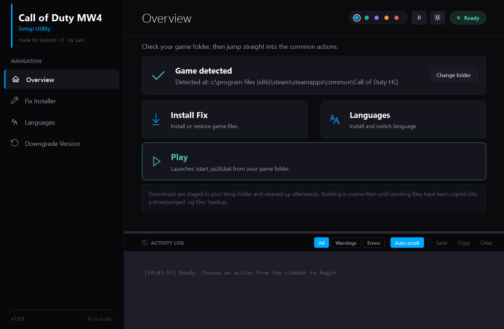
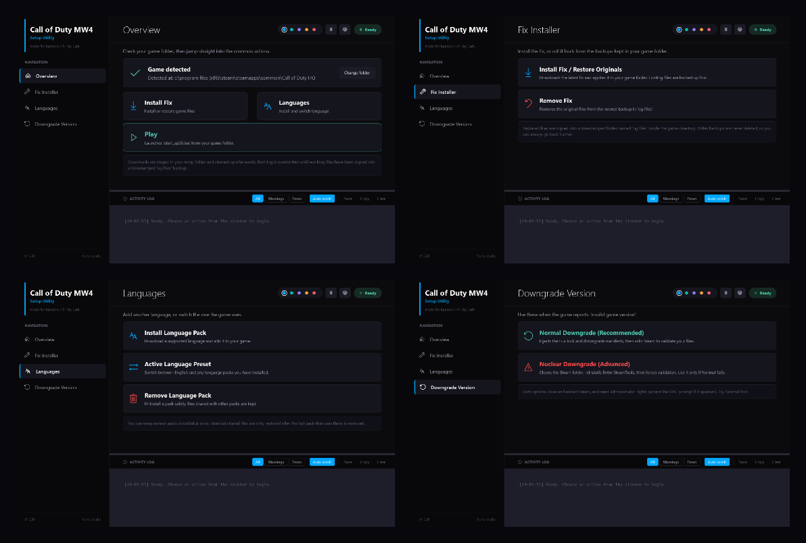
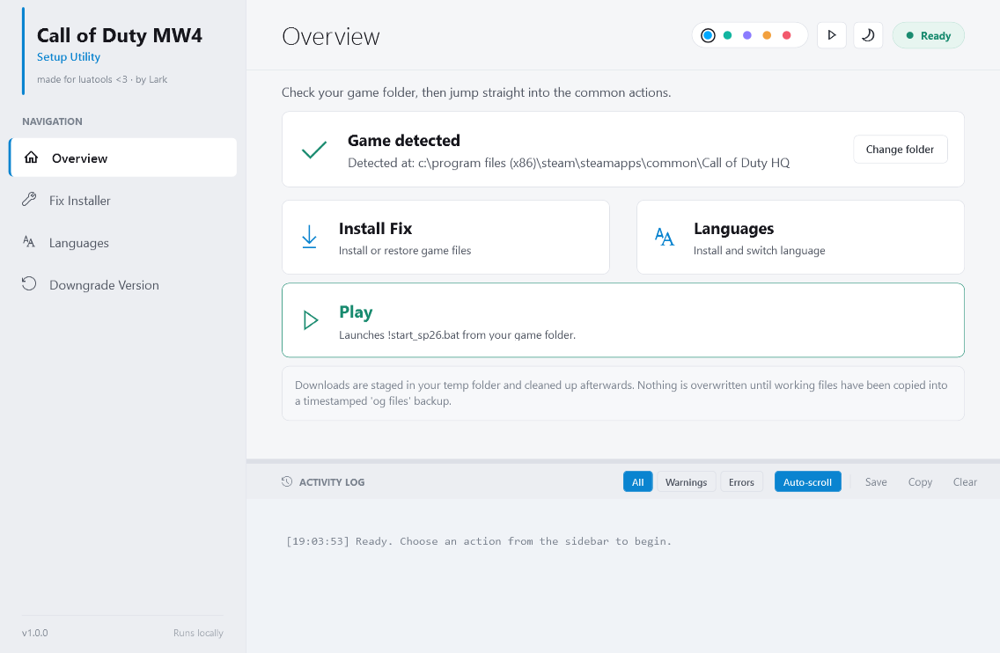
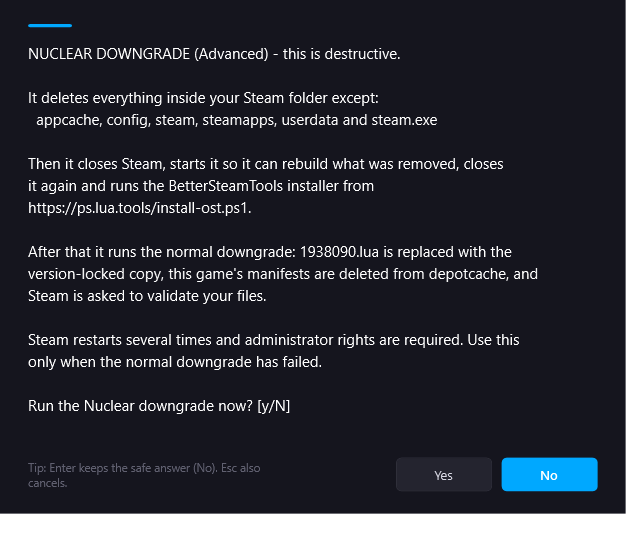

# Call of Duty MW4 Setup Utility

A small Windows GUI that installs the fix, manages language packs and repairs the
"Invalid game version" error for **Call of Duty HQ** (Steam app `1938090`).

Made for luatools. Everything runs locally — no telemetry, no accounts, no background
services.



## Install

Windows PowerShell (5.1 or newer, shipped with Windows 10 and 11):

```powershell
irm https://raw.githubusercontent.com/LarkTheStar/fix-installer/main/install.ps1 | iex
```

That downloads the utility, starts it as its own process and gives your terminal its
prompt back. The window stays open after the terminal is closed.

Prefer a file? Download `install.ps1` and run it:

```powershell
powershell -NoProfile -STA -ExecutionPolicy Bypass -File .\install.ps1
```

No installation, no leftovers: the script is the program.

## What it does

| Page | Actions |
| --- | --- |
| **Overview** | Shows the detected game folder, installs the fix, opens languages, and a green **Play** card that launches `!start_sp26.bat` |
| **Fix Installer** | Installs or restores the fix, removes it again from the newest backup |
| **Languages** | Installs a language pack, switches the active preset, removes a pack |
| **Downgrade Version** | Normal or Nuclear downgrade for "Invalid game version" |

The game folder is detected from your Steam libraries. If detection fails, **Change
folder** lets you pick it by hand; the choice is saved and used for every action, and
the utility warns you if the folder does not look like Call of Duty HQ.

Light and dark themes, five accent colours, a reduce-motion switch, and the window
size, position and last page are remembered between sessions. The activity log can be
dragged taller by the bar above it, and **Save** writes the transcript with a
diagnostics header (version, Windows build, PowerShell version, whether it ran
elevated, Steam libraries, the folder in use) so a bug report is one file.





## What it changes on your PC

| Location | Why |
| --- | --- |
| Your game folder | Replaced files are backed up to a timestamped `og files` folder first; removing the fix restores from it |
| `%TEMP%` | Downloads are staged there and cleaned up afterwards |
| `<Steam>\config\stplug-in\1938090.lua` | The downgrade replaces this Lua file with a version-locked copy |
| `<Steam>\depotcache` | The downgrade deletes **this game's** manifests so Steam re-fetches them |
| `%LOCALAPPDATA%\CallOfDutyHQ-SetupUtility\settings.json` | Your saved folder, theme, accent and window state |
| `%LOCALAPPDATA%\CallOfDutyHQ-SetupUtility\worker.json`, `last-run.json` | Hand-off between the normal window and the administrator window during a downgrade; the first is removed when the run hands back, the second is how the normal window reports the result |
| `%LOCALAPPDATA%\CallOfDutyHQ-SetupUtility\logs` | The log of an administrator downgrade run, saved automatically before that window closes |

Nothing else is written outside those paths, and older backups are never deleted on
their own, so you can always step further back. The one exception is a downgrade: it
deletes `og files` deliberately (see below), because backups of the other version are
worse than useless.

**Network access:** GitHub releases (fix archive and downgrade manifests) and
`ps.lua.tools` (only during the Nuclear downgrade, to install BetterSteamTools).

## The Nuclear downgrade

Nuclear is destructive and asks for confirmation first. It closes Steam and deletes
everything in the Steam folder **except** `appcache`, `config`, `steam`, `steamapps`,
`userdata` and `steam.exe`. It then starts Steam so it can rebuild what was removed,
closes it, installs BetterSteamTools, and finally runs the same steps as the Normal
downgrade.

**Both downgrades begin by undoing an applied fix.** If `og files` is present, you are
asked to confirm, the originals are restored from the newest backup, and then the
whole `og files` folder is deleted. The downgrade changes which game version is
installed, so files and backups made for the old one no longer belong there. Declining
cancels the downgrade rather than leaving two versions mixed together.



Use it only when Normal fails. Both downgrades close and restart Steam and need
administrator rights — accept the UAC prompt when it appears.

Accepting the prompt hands over to an **administrator window** that stays visible for
the whole run: the title changes, a banner names the running downgrade, and the
activity log fills in live, step by step. That window cannot be closed while the work
is in progress, because interrupting it half way leaves Steam in a worse state than
before.

When the run ends, the banner in that window reports the result, the log is saved to
`%LOCALAPPDATA%\CallOfDutyHQ-SetupUtility\logs`, and a message box appears with the
result and the log path. Press **OK** on it: that press is the hand-back. The
administrator window closes, so no elevated session is left sitting there, and the
window you started from comes back with the same result.

While that window works, the window you started the utility from minimizes and stays
out of the way — you should only ever see one window at a time. It returns by itself
once the administrator window is closed, with the outcome and the log path already in
its activity log, so you can carry on without relaunching.

## Troubleshooting

- **Game not detected** — click **Change folder** and pick
  `...\steamapps\common\Call of Duty HQ`.
- **"Scripts are disabled on this system"** — run
  `powershell -NoProfile -STA -ExecutionPolicy Bypass -File .\install.ps1` instead of
  double-clicking the file.
- **Files are locked during install** — the utility stops the anti-cheat services and
  the game process itself; if a file is still locked, close Steam and the game and try
  again.
- **It looks like nothing is happening** — the downgrade restarts Steam several times
  and waits for it to load, so quiet minutes are normal. Watch the activity log in the
  administrator window; it is never silent for long, and every step it takes appears
  there.
- **Something failed** — the activity log records every step. Press **Save** and attach
  the `.txt` to your report; it contains the exact error, the call stack, and a header
  with your version, Windows and PowerShell build, elevation state and Steam paths.

## Antivirus notice

This is an unsigned PowerShell script that deletes files inside your Steam folder on
request, and the Nuclear downgrade downloads and runs the BetterSteamTools installer
from `ps.lua.tools`. SmartScreen and some antivirus products will warn about that — the
source is right here and nothing is obfuscated. Read it before running it; that advice
applies to every script you find online, including this one.

## Notes

- Windows 10/11, Windows PowerShell 5.1. PowerShell 7 also works — the utility
  relaunches itself under `powershell.exe -STA`, because WPF needs an STA thread.
- The script is self-relaunching: started through `irm ... | iex` it saves itself to a
  temporary file and runs from there, which is what allows the elevated relaunch for the
  downgrades.
- If you fork this, update `$ScriptRawUrl` at the top of `install.ps1` so the elevated
  relaunch fetches your copy.
- Keep `install.ps1` pure ASCII and save it **without** a byte-order mark. `irm ... | iex`
  hands the script to PowerShell as a string, and a leading BOM makes Windows PowerShell
  5.1 fail on the `param` block; the non-English language names are stored as `\uXXXX`
  escapes for exactly this reason.

## Version

`1.0.0` — the value lives in `$AppVersion` at the top of the script and is shown in the
sidebar.

## License

MIT — see [LICENSE](LICENSE).
