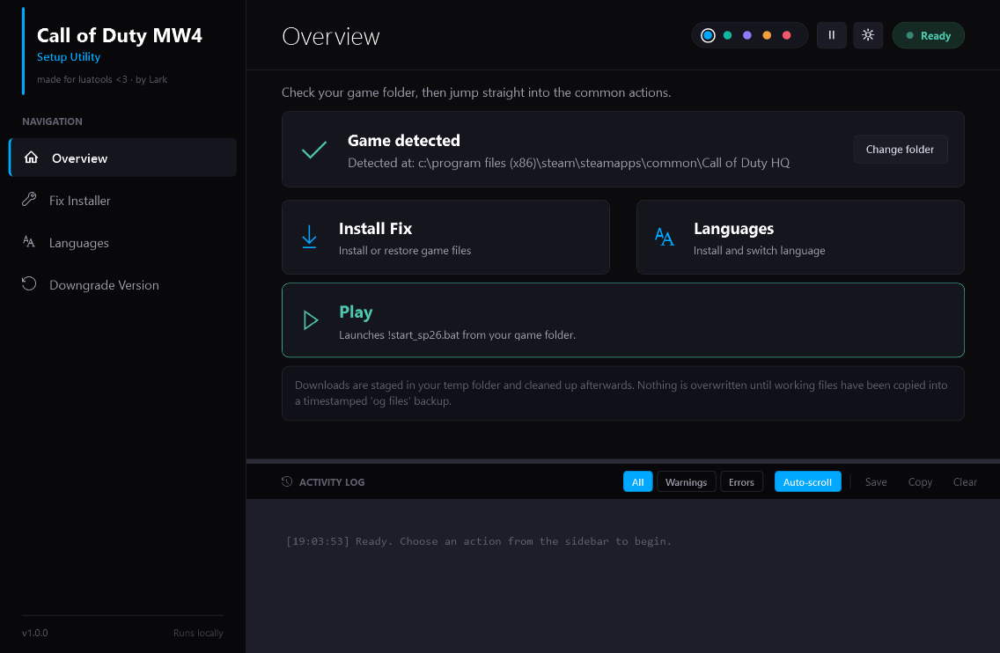
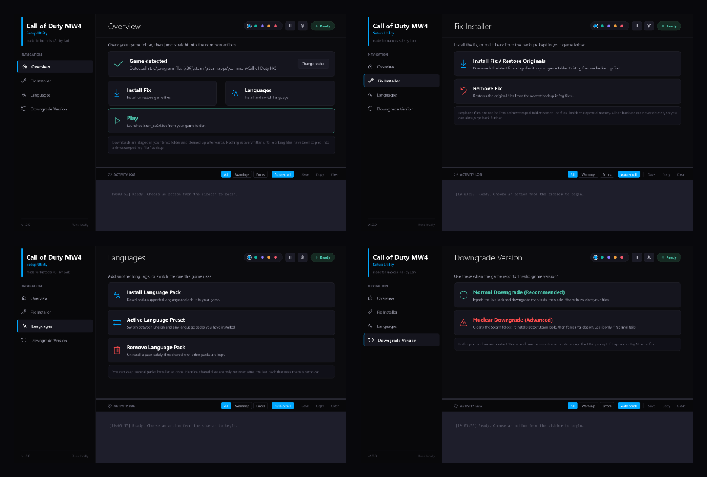
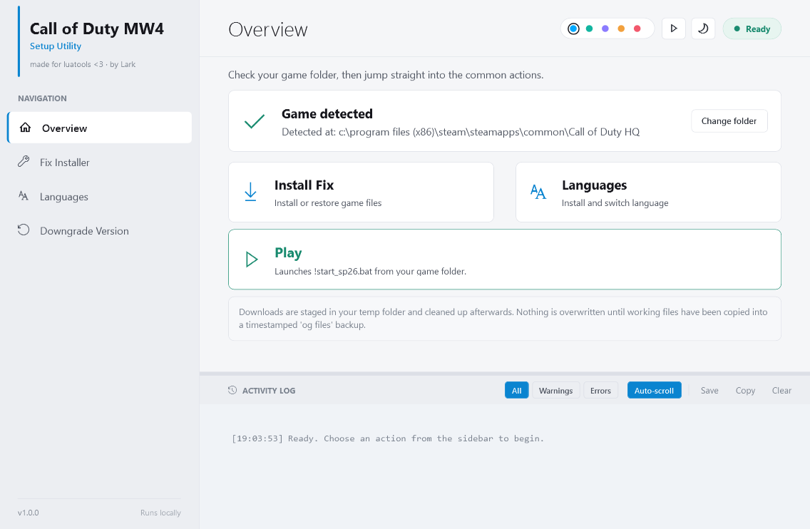
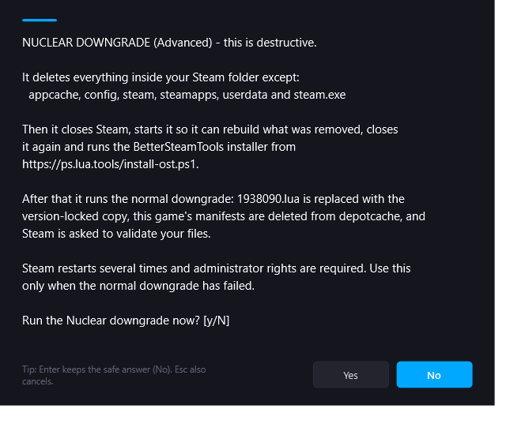

# Call of Duty MW4 Setup Utility

A small Windows GUI that installs the fix, manages language packs and repairs the
"Invalid game version" error for **Call of Duty HQ** (Steam app `1938090`).

Made for luatools. Everything runs locally — no telemetry, no accounts, no background
services.



## Install

Windows PowerShell (5.1 or newer, shipped with Windows 10 and 11):

```powershell
irm https://raw.githubusercontent.com/LarkTheStar/fix-installer/main/install.ps1 | iex
```

That downloads the utility, starts it as its own process and gives your terminal its
prompt back. The window stays open after the terminal is closed.

Prefer a file? Download `install.ps1` and run it:

```powershell
powershell -NoProfile -STA -ExecutionPolicy Bypass -File .\install.ps1
```

No installation, no leftovers: the script is the program.

Or use the exe: download `CodHQ-Setup.exe` from the
[Releases](https://github.com/LarkTheStar/fix-installer/releases) page (the
`app-v<version>` pre-releases) and double-click it. It is the same utility, with the
script embedded in a small launcher. It is not code-signed yet, so Windows may show
"Windows protected your PC" the first time: **More info** > **Run anyway**. How it is
built and what comes next: [docs/exe-plan.md](docs/exe-plan.md).

## What it does

| Page | Actions |
| --- | --- |
| **Overview** | Shows the detected game folder, installs the fix, opens languages, and a green **Play** card that launches `!start_sp26.bat` |
| **Fix Installer** | Installs or restores the fix, removes it again by putting back exactly the originals its backups recorded, then deletes `og files` |
| **Languages** | Installs a language pack, switches the active preset, removes a pack |
| **Downgrade Version** | Normal or Nuclear downgrade for "Invalid game version" |
| **Games** | The older Call of Duty games you own on Steam, with their community clients: install, update, remove, play every mode, check BO3/BO4 executables, enter your own CD key (see below) |

The game folder is detected from your Steam libraries. If detection fails, **Change
folder** lets you pick it by hand; the choice is saved and used for every action, and
the utility warns you if the folder does not look like Call of Duty HQ.

Light and dark themes, five accent colours, a reduce-motion switch, and the window
size, position and last page are remembered between sessions. The activity log can be
dragged taller by the bar above it, and **Save** writes the transcript with a
diagnostics header (version, Windows build, PowerShell version, whether it ran
elevated, Steam libraries, the folder in use) so a bug report is one file.





## What it changes on your PC

| Location | Why |
| --- | --- |
| Your game folder | Replaced files are backed up to a timestamped `og files` folder first, together with a small record (`.codhq-fix-backup.json`) of which files were replaced and which the fix added. Removing the fix puts back exactly those originals and deletes exactly those added files, then deletes `og files` |
| `%TEMP%` | Downloads are staged there and cleaned up afterwards |
| `<Steam>\config\stplug-in\1938090.lua` | The downgrade replaces this Lua file with a version-locked copy. The old one is moved to a temporary backup and only deleted once the new Lua file and manifests are in place; if a download fails, it is put back |
| `<Steam>\depotcache` | The downgrade replaces **this game's** manifests with the version-locked ones. The old ones are kept in the same temporary backup and restored if a download fails. Any Steam file the manifest archive would overwrite is kept in that backup too, and put back if the extraction fails |
| `%LOCALAPPDATA%\CallOfDutyHQ-SetupUtility\settings.json` | Your saved folder, theme, accent and window state |
| `%LOCALAPPDATA%\CallOfDutyHQ-SetupUtility\worker.json`, `last-run.json` | Hand-off between the normal window and the administrator window during a downgrade; the first is removed when the run hands back, the second is how the normal window reports the result. Always written to the folder of the account that started the utility, even when the administrator is a different account |
| `%LOCALAPPDATA%\CallOfDutyHQ-SetupUtility\logs` | The log of an administrator downgrade run, saved automatically before that window closes (same folder rule as above) |
| Games: the game's folder | A client's files, a record of them (`.codhq-client-<id>.json`) and copies of any of your game files it replaced (`.codhq-backups\<id>\`). **Remove** puts the folder back exactly |
| Games: `%LOCALAPPDATA%\<client>` | Files some clients keep outside the game: `CallofDuty4MW`, `boiii`, `h1-mod`, `auroramod\iw7-mod`, `h2-mod`, and Plutonium's own `Plutonium` folder (its `config.json` gets the game paths; your login is kept) |
| Games: `HKCU\...\Activision\...` | Only when you enter your own CD key for CoD4: the value the game reads, backed up first to `%LOCALAPPDATA%\CallOfDutyHQ-SetupUtility\cdkey-backups` |

Nothing else is written outside those paths. `og files` is deleted only after its
originals have been put back: by **Remove fix** once every file is restored, and at
the start of a downgrade (see below). Every original is checked before anything is
changed, and if any file fails to restore, nothing is deleted. An install that fails
half way rolls its files back and removes its own partial backup, so a broken backup
can never be mistaken for the real originals later. Backups have no size limit.
Downloaded copies of the utility in `%TEMP%` (`codhq-setup-*.ps1`) are deleted when
the window closes; any left by a crash are removed a day later.

Removing the fix also deletes the folders the fix created, once they are empty.

**Network access:** GitHub releases (fix archive, language packs and downgrade
manifests) and `ps.lua.tools` (only during the Nuclear downgrade, to install
BetterSteamTools). The Games page also uses CB Servers' public client repository (its
CDN `cdn-na.cbservers.xyz` / `cdn-eu.cbservers.dev` under `/updater/`, then GitHub
`CBServers/updater`), Plutonium's `cdn.plutonium.pw`, and the T6SP-Mod release on
GitHub, only when you install, update or check a client. Removing the fix needs no network, except for backups made by
versions from before the backup record existed: for those the fix archive is
downloaded once and compared file by file, so only files that are exactly the fix's
are deleted, each original is taken from the oldest backup that really holds one, and
anything else is left alone and listed in the log.

**Every download is checked.** Each file from this repository's releases has its
SHA-256 written into `install.ps1` (`Get-ReleaseAssetHash`); a download that does not
match is deleted and nothing is installed from it. A dropped connection is retried up
to four times, continuing from the bytes already received, so a multi-gigabyte
language pack does not start over. After replacing a release file, run
`tools\Get-ReleaseHashes.ps1` and paste its output into `Get-ReleaseAssetHash` in the
same commit; until then the utility refuses the new file.

## Games

The **Games** page lists 14 older titles: CoD4, World at War, MW2, Black Ops, MW3,
Black Ops II, Ghosts, Advanced Warfare, Black Ops III, Infinite Warfare, Modern
Warfare Remastered, MW2 Campaign Remastered, Black Ops 4 and HorizonMW. It finds each game in your Steam libraries (or the folder you pick)
and installs the community client that brings it back online:

| Clients | Games |
| --- | --- |
| Plutonium | World at War, Black Ops, Black Ops II (MP, Zombies), MW3 (MP) |
| IW4x, AlterWare | MW2 (MP; campaign and Spec Ops), MW3 (campaign, Spec Ops) |
| iw3x or CoD4x, IW3SP-Mod | CoD4 (MP; campaign) |
| T6SP-Mod | Black Ops II (campaign) |
| IW6x, S1x, BOIII, IW7-Mod, H1-Mod, H2-Mod | Ghosts, AW, BO3, IW, MWR, MW2 Campaign Remastered |
| Shield's official launcher | Black Ops 4 (Project BO4: online or offline) |
| HorizonMW's official launcher | HorizonMW (on Modern Warfare Remastered) |
| AuroraMod's H1-Mod release | MWR (as an alternative to CB's build) |

How it decides what to download comes from a file-by-file audit of the CB Servers
launcher's public client manifests (`docs/cb-launcher/`, re-run with
`tools\Invoke-CbManifestAudit.ps1`):

- a client file is downloaded only when the client project itself publishes it, and
  checked against its SHA-1 (or a pinned SHA-256);
- copies of a game's own files (executables, the Bink and Miles libraries, BO3/BO4
  executables) are never downloaded: your own are used, and where a client needs one
  under another name it is made from yours when it is the right build;
- a file added to a manifest after the audit is skipped until the catalogue is updated;
- Activision's game files are never downloaded: Shield's launcher fetches what
  Project BO4 needs itself;
- full game downloads, CB's copies of the BO3/BO4 executables and the CD keys built
  into the CB launcher are not used (`docs/cb-launcher/unavailable.md` explains why
  and what to do instead).

**Play** builds the exact command line the CB launcher uses for each mode and adds
your player name; it warns when your game build differs from the one the client was
installed against. **Check game exe** compares your own `BlackOps3.exe` /
`BlackOps4.exe` with the build its client expects. **CD key** shows your key masked,
backs it up, saves the key you type (from Steam: right-click the game > Manage > CD
Keys) and restores a backup; keys never appear in the activity log. Plutonium games
need a free Plutonium account: use **Plutonium login** once.

**Black Ops 4 (Project BO4).** Install puts Shield's official launcher in the game
folder, as its guide says, after backing up your `BlackOps4.exe` and `LPC` files. It
then runs that launcher without a window to download the client, the support mod and
Target Range (about 2.2 GB). **Play: Online** / **Play: Offline** writes your name and
the server into `project-bo4.json` and opens Shield's launcher; press Play Client
there. **Repair** deletes `BlackOps4.start` (Shield's fix for a black screen at start).
**Remove** deletes everything the launcher added and puts your exe and LPC files back.

**HorizonMW.** Install puts HorizonMW's official launcher in its own folder, as its
guide says, copies your MWR folder to the clipboard and opens it. In the launcher,
set that folder as the install directory and press Verify game files. **Play** then
starts `hmw-mod.exe` with your name. Remove lists what the launcher added to the MWR
folder and asks before deleting it.

**Updates.** **Check for updates** covers every client: CB's manifests, Plutonium's
revision, the newest GitHub release of T6SP-Mod and AuroraMod's H1-Mod
(each checked against GitHub's published digest), Shield's content (asked of its own
launcher) and HorizonMW's launcher version.

## The Nuclear downgrade

Nuclear is destructive and asks for confirmation first. It closes Steam and deletes
everything in the Steam folder **except** `appcache`, `config`, `steam`, `steamapps`,
`userdata` and `steam.exe`. It then starts Steam so it can rebuild what was removed,
closes it, installs BetterSteamTools, and finally runs the same steps as the Normal
downgrade. The BetterSteamTools installer runs in its own PowerShell process, with its
output shown line by line in the activity log; if it fails or takes longer than 10
minutes, that is logged as a warning and the downgrade carries on. Its configuration
reads Lua files from `config\stplug-in`, so Nuclear creates that folder when it is
missing.

**Both downgrades first check that they can run.** Steam must be found with its
`steam.exe`, and the Normal downgrade also needs `config\stplug-in` (SteamTools or
BetterSteamTools). This is checked before the UAC prompt and again in the
administrator window; if anything is missing, the downgrade stops there and nothing
is changed. The version-locked Lua file and manifests are then downloaded (and
checked) before anything else happens, so a network problem also stops the downgrade
while your fix and Steam are still untouched.

**Both downgrades then undo an applied fix.** If `og files` is present, you are asked
to confirm, the originals recorded in its backups are put back, and then the whole
`og files` folder is deleted. The downgrade changes which game version is installed,
so files and backups made for the old one no longer belong there. Declining cancels
the downgrade rather than leaving two versions mixed together.



Use it only when Normal fails. Both downgrades close and restart Steam and need
administrator rights — accept the UAC prompt when it appears.

Accepting the prompt hands over to an **administrator window** that stays visible for
the whole run: the title changes, a banner names the running downgrade, and the
activity log fills in live, step by step. That window cannot be closed while the work
is in progress, because interrupting it half way leaves Steam in a worse state than
before.

When the run ends, the banner in that window reports the result, the log is saved to
`%LOCALAPPDATA%\CallOfDutyHQ-SetupUtility\logs`, and a message box appears with the
result and the log path. Press **OK** on it: that press is the hand-back. The
administrator window closes, so no elevated session is left sitting there, and the
window you started from comes back with the same result.

While that window works, the window you started the utility from minimizes and stays
out of the way — you should only ever see one window at a time. It returns by itself
once the administrator window is closed, with the outcome and the log path already in
its activity log, so you can carry on without relaunching. This also works when the
UAC prompt asks for a different administrator account: the window you started passes
its own settings folder and the game folder it uses to the administrator window.

## Troubleshooting

- **Game not detected** — click **Change folder** and pick
  `...\steamapps\common\Call of Duty HQ`.
- **"Scripts are disabled on this system"** — run
  `powershell -NoProfile -STA -ExecutionPolicy Bypass -File .\install.ps1` instead of
  double-clicking the file.
- **Files are locked during install** — the utility stops the anti-cheat services and
  the game process itself; if a file is still locked, close Steam and the game and try
  again.
- **It looks like nothing is happening** — the downgrade restarts Steam several times
  and waits for it to load, so quiet minutes are normal. Watch the activity log in the
  administrator window; it is never silent for long, and every step it takes appears
  there.
- **Something failed** — the activity log records every step. Press **Save** and attach
  the `.txt` to your report; it contains the exact error, the call stack, and a header
  with your version, Windows and PowerShell build, elevation state and Steam paths.

## Antivirus notice

This is an unsigned PowerShell script that deletes files inside your Steam folder on
request, and the Nuclear downgrade downloads and runs the BetterSteamTools installer
from `ps.lua.tools`. SmartScreen and some antivirus products will warn about that — the
source is right here and nothing is obfuscated. Read it before running it; that advice
applies to every script you find online, including this one.

## Notes

- Windows 10/11, Windows PowerShell 5.1. PowerShell 7 also works — the utility
  relaunches itself under `powershell.exe -STA`, because WPF needs an STA thread.
- The script is self-relaunching: started through `irm ... | iex` it saves itself to a
  temporary file and runs from there, which is what allows the elevated relaunch for the
  downgrades.
- If you fork this, update `$ScriptRawUrl` at the top of `install.ps1` so the elevated
  relaunch fetches your copy.
- Keep `install.ps1` pure ASCII and save it **without** a byte-order mark. `irm ... | iex`
  hands the script to PowerShell as a string, and a leading BOM makes Windows PowerShell
  5.1 fail on the `param` block; the non-English language names are stored as `\uXXXX`
  escapes for exactly this reason.

## Tests

`tests\` holds Pester 5 tests for the parts that work on files: settings, the fix
install and removal (including backup records, failed installs and backups from older
versions), language packs, the `configs.user.ini` edits, ZIP path checks, the
downgrade's checks before it starts and its download-first order, its Lua/manifest
backup and restore, the out-of-process script runner, the administrator hand-off
folder, sandbox mode, and the downloader itself (retries, resume, HTTP status codes and
checksums, against a small local test server). For the Games page: the catalogue
against the audit (nothing denied or untraced can ever be downloaded), detection,
CB manifest reading, client install / update / remove with backups, derived files,
conflicts and rollback, Plutonium's `config.json`, launch commands, the executable
check, and the CD-key cycle against a throwaway registry key. Steam, services,
processes and prompts are mocked, so running them touches nothing on your PC.

```powershell
Install-Module Pester -RequiredVersion 5.7.1 -Scope CurrentUser -Force -SkipPublisherCheck
powershell -NoProfile -ExecutionPolicy Bypass -File .\tests\Invoke-Tests.ps1
powershell -NoProfile -STA -ExecutionPolicy Bypass -File .\tests\Test-Xaml.ps1
```

GitHub Actions runs all of it on every push, under both Windows PowerShell 5.1 and
PowerShell 7, checks that the window layout loads, and runs the window test below.

`tests\Test-Gui.ps1` starts the real window from a temp copy and drives it with UI
Automation: every page, the theme and accent switches, the activity log, and the
cleanup of temp copies. It needs a desktop session, and the mouse moves while it
clicks the sidebar. It presses no action buttons and puts `settings.json` back
afterwards.

```powershell
powershell -NoProfile -STA -ExecutionPolicy Bypass -File .\tests\Test-Gui.ps1
```

### Sandbox: testing a real downgrade and the UAC hand-off safely

`tests\Start-Sandbox.ps1` builds a sandbox in `%TEMP%\codhq-sandbox` - a fake Steam
folder, a fake game folder and a private settings folder - and starts the utility
against it with `-Sandbox`. The title ends in **[SANDBOX]**, and in that window every
button really runs, including both downgrades, the UAC prompt and the administrator
window, but only the sandbox changes: Steam is never closed or started,
BetterSteamTools is not installed, and settings, hand-off files and logs stay in the
sandbox. Downloads are real, so the checksums and the network side are tested too.

```powershell
powershell -NoProfile -ExecutionPolicy Bypass -File .\tests\Start-Sandbox.ps1          # build and start
powershell -NoProfile -ExecutionPolicy Bypass -File .\tests\Start-Sandbox.ps1 -Report  # what changed
powershell -NoProfile -ExecutionPolicy Bypass -File .\tests\Start-Sandbox.ps1 -Reset   # start over
```

To test the hand-off with a second administrator account, run it from the normal
account and type the other account's password at the UAC prompt. A real downgrade
against real Steam still needs a manual run before a release.

The sandbox also has fake CoD4, MW2, Black Ops II, Ghosts, MWR and Black Ops 4 folders
for the Games page. The full test plan for every game, including the checks only real
games can do, is [docs/testing.md](docs/testing.md).

`tests\Test-Exe.ps1` checks the exe built by `tools\Build-Exe.ps1` (version, icon, the
embedded script, argument passing); with `-Launch` it also opens the real window from
the exe in sandbox mode.

## Version

`1.1.0` — the value lives in `$AppVersion` at the top of the script and is shown in the
sidebar.

## License

MIT — see [LICENSE](LICENSE).
